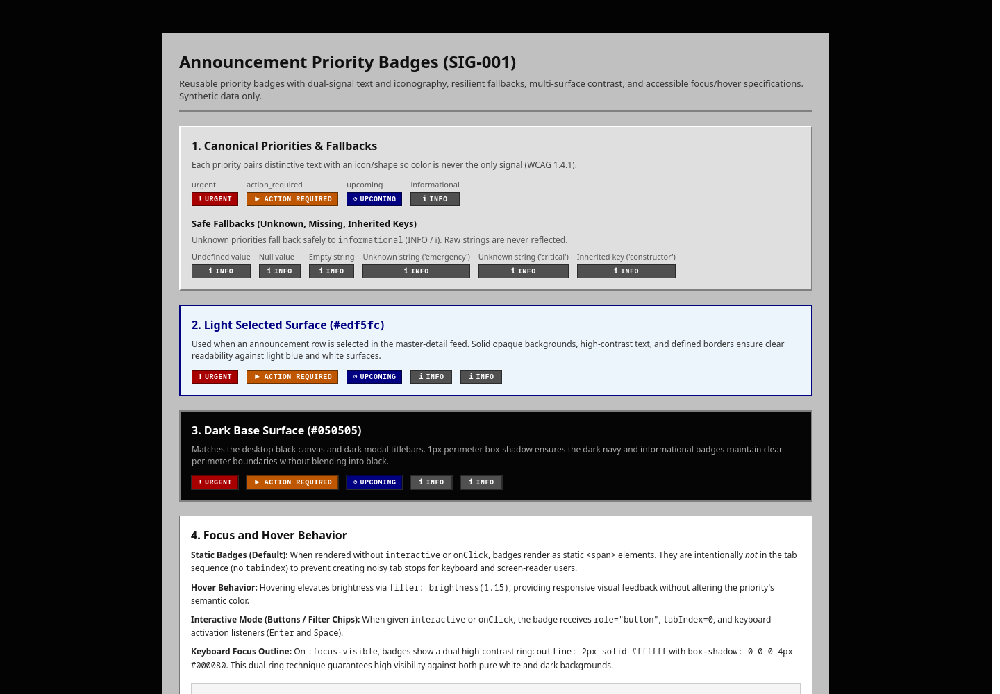
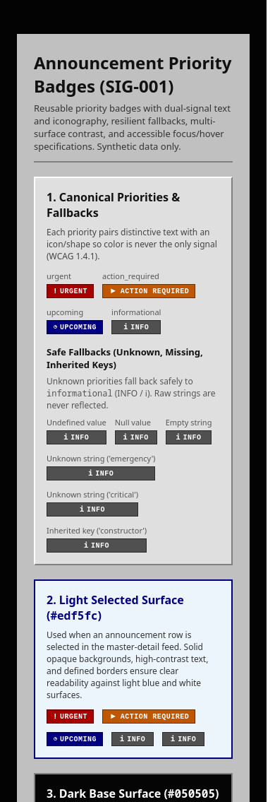

# Announcement priority badge (SIG-001)

```tsx
import { AnnouncementPriorityBadge } from "@/components/announcement-priority-badge";

<AnnouncementPriorityBadge priority="urgent" />
<AnnouncementPriorityBadge priority="action_required" />
<AnnouncementPriorityBadge priority="upcoming" />
<AnnouncementPriorityBadge priority="informational" />
```

A reusable presentation component for announcement priorities (`urgent`, `action_required`,
`upcoming`, `informational`). The component accepts optional string/null values so existing
fixtures and normalized records can use them without casts.

Supported priority keys:
- `urgent`: label **URGENT**, icon `!`, tone high-urgency red (`#a80000`)
- `action_required`: label **ACTION REQUIRED**, icon `▶`, tone amber/orange (`#bf5600`)
- `upcoming`: label **UPCOMING**, icon `◷`, tone navy (`#000080`)
- `informational`: label **INFO**, icon `ℹ`, tone neutral dark gray (`#505050`)

Missing/unknown values display **INFO** with neutral informational styling. Raw unknown strings
are never reflected into the UI or attributes. Own-key checks also prevent prototype properties
such as `constructor` or `__proto__` from being mistaken for approved values. Priority classification
remains strictly in the domain/fixture extraction layer; the badge component handles presentation only.

## Accessibility and appearance

- Every priority pairs visible text with an icon/shape; color is never the only signal (WCAG 1.4.1).
- Screen readers receive an accessible `Priority: ` prefix. Decorative icons are marked `aria-hidden="true"`.
- Each tone has an opaque background and high-contrast text conforming to WCAG AA/AAA contrast ratios.
- The component works seamlessly on light selected surfaces (`#edf5fc` / `#ffffff`) and the dark base surface (`#050505` / `#151515`).
- A subtle 1px perimeter shadow preserves clear badge boundaries when placed on pitch-black surfaces.
- Forced-colors mode (Windows High Contrast) uses system colors (`CanvasText`, `Canvas`, and `Highlight`).

## Focus and hover behavior

- **Static metadata (default)**: When rendered without `interactive` or `onClick`, badges render as static `<span>` elements without a `tabIndex` or button role. This avoids cluttering keyboard tab stops or disrupting screen reader linearity.
- **Hover behavior**: Hovering provides subtle brightness elevation (`filter: brightness(1.15)`) while preserving the priority's semantic color identity.
- **Interactive mode (filters / chips)**: When passed `interactive` or `onClick`, the badge receives `tabIndex={0}`, `role="button"`, cursor pointer, and keyboard activation (`Enter` and `Space` keys).
- **Focus visible**: On keyboard focus (`:focus-visible`), a high-contrast dual ring (`outline: 2px solid #ffffff; outline-offset: 2px; box-shadow: 0 0 0 4px #000080;`) provides prominent visibility against both light and dark backgrounds.

## Review example and checks

`docs/examples/announcement-priority-badge.tsx` renders all priorities, safe fallbacks, light selected surfaces, dark base surfaces, interactive focus/hover states, and real fixtures. For local visual review, temporarily render its default export in a development page:

```tsx
export { default } from "../../../docs/examples/announcement-priority-badge";
```

For example, put that line in `src/app/badge-preview/page.tsx`, run `npm run dev`, and visit `/badge-preview`. Remove the temporary route after review; the contribution adds no permanent example route or navigation item.

Run `npm test -- src/components/announcement-priority-badge.test.tsx` for unit test coverage of all approved priorities, safe fallbacks, interactive modes, accessibility attributes, and synthetic fixtures. Run `npm run check` for all required lint, TypeScript, and test checks.

Visual evidence from the example at desktop and mobile widths:




