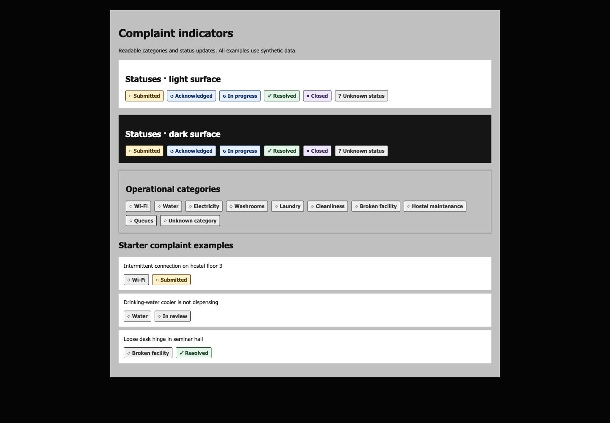
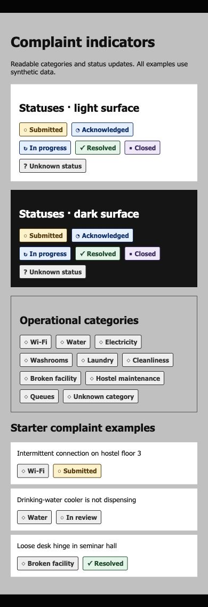

# Complaint indicators (SIG-005)

```tsx
import {
  ComplaintCategoryIndicator,
  ComplaintStatusIndicator,
} from "@/components/complaint-indicators";

<ComplaintCategoryIndicator category="hostel_maintenance" />
<ComplaintStatusIndicator status="in_progress" />
```

Both components accept optional string/null values so existing fixtures and
future normalized records can use them without casts. This is presentation only:
no backend validation, status transitions, complaint feed, or timeline is added.

Supported category keys: `wifi`, `water`, `electricity`, `washrooms`, `laundry`,
`cleanliness`, `broken_facility`, `hostel_maintenance`, `queues`. These cover the
operational categories in the README. Underscores are replaced by readable labels.

The canonical workflow statuses are `submitted`, `acknowledged`, `in_progress`,
`resolved`, and `closed`. The existing fixture's legacy `in_review` value is
displayed as a neutral **In review** indicator; it is not silently converted into
another workflow state. This keeps the starter fixture usable until the separate
domain-model issue decides how to migrate it.

Missing/unknown values display **Unknown category** or **Unknown status** with
neutral styling. Raw unknown strings are never reflected into the UI. Own-key
checks also keep inherited object keys such as `constructor` from being mistaken
for approved values. A fallback is not permission to store a prohibited category;
submission validation remains the domain layer's responsibility.

## Accessibility and appearance

- Every category and status has visible text; color and symbols are supplementary.
- Screen readers receive a Category/Status prefix. Decorative symbols are hidden.
- Indicators are static text: no tab stops, hover actions, buttons, or live regions.
- Each tone has an opaque background and high-contrast text for light/dark parents.
- Labels wrap within the available width. Forced-colors mode uses system colors
  and a visible border.

## Review example and checks

`docs/examples/complaint-indicators.tsx` renders all categories, every canonical
status, neutral fallbacks, and the existing synthetic fixtures. For local visual
review, temporarily render its default export in a development page:

```tsx
export { default } from "../../../docs/examples/complaint-indicators";
```

For example, put that line in `src/app/indicator-preview/page.tsx`, run
`npm run dev`, and visit `/indicator-preview`. Remove the temporary route after
review; the contribution adds no permanent example route or navigation item.

Run `npm test -- src/components/complaint-indicators.test.tsx` for component
coverage of all approved keys, legacy/missing/unknown values, inherited keys,
untrusted markup, fixture reuse, and static accessible output. Run `npm run check`
for all required lint, TypeScript, and unit checks.

Visual evidence from the example at desktop and mobile widths:



